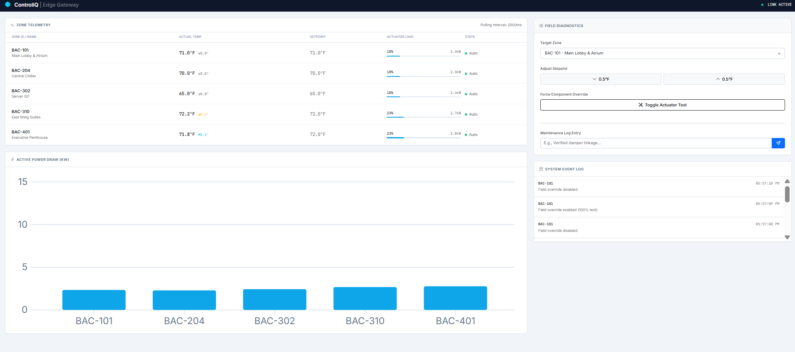

# ControlIQ Edge API & Telemetry Dashboard (Prototype)

🟢 **Live Interactive Demo:** [Click here to view the live dashboard](https://YOUR-RENDER-URL.onrender.com)

A lightweight proof-of-concept demonstrating edge telemetry simulation, REST API state management, and real-time data visualization. Built as a technical showcase for **Systems Automation, Inc. (SAI)**, this project illustrates how I approach building automation concepts (such as BACnet polling, HVAC setpoints, and thermal drift monitoring) using my current primary tech stack.

## 🎯 Project Objective
The goal of this 2-hour sprint was to model the core mechanics of a building telemetry system—specifically the architectural patterns required to poll sensor data, evaluate anomalies in real-time, and expose field controls via a web interface. 

While this prototype is built using **Python, FastAPI, and D3.js**, the underlying concepts—RESTful APIs, background task state management, and responsive UI updates—are directly translatable to the **C# / .NET / Blazor** ecosystem used by ControlIQ.

## 🚀 Key Features
* **Simulated Edge Telemetry Engine:** An asynchronous Python background task generating realistic building sensor data every 2.5 seconds (Current Temp, Setpoint, HVAC Valve %, and kW Power Draw) across 5 commercial zones.
* **RESTful FastAPI Backend:** Endpoints to serve live zone states and accept POST commands for field engineer overrides and setpoint adjustments.
* **Real-Time D3.js Visualization:** A dynamic, responsive bar chart rendering real-time power draw (kW) per zone, updating continuously without page reloads.
* **Automated Fault Detection:** Client-side evaluation triggering UI alerts when any zone experiences a thermal drift of >3.0°F from its active setpoint.
* **SQLite Maintenance Audit Trail:** A local database logging all manual field overrides and preventive maintenance notes submitted through the UI.

## 🛠️ Tech Stack
* **Backend:** Python, FastAPI, Uvicorn, SQLite
* **Frontend:** HTML5, Bootstrap 5, JavaScript (ES6+), D3.js (v7)
* **Architecture:** Asynchronous background polling, REST API, localized data persistence.

## 🔒 Security & DevOps Configuration
This repository is configured with enterprise standard workflows to ensure code health and security:
* **Dependabot:** Enabled for automated dependency vulnerability scanning (`requirements.txt`).
* **Secret Scanning:** Active to prevent accidental commits of API keys or environment variables.
* **Environment Isolation:** Backend designed to compile via PyInstaller into a standalone executable, keeping source code abstracted from edge deployments.

## ⚙️ How to Run Locally
1. Clone this repository: `git clone https://github.com/YourUsername/ControlIQ-Edge-API.git`
2. Navigate to the project directory: `cd ControlIQ-Edge-API`
3. Install dependencies: `pip install fastapi uvicorn`
4. Start the server: `uvicorn main:app --reload`
5. Open a browser to `http://localhost:8000` to view the live dashboard.